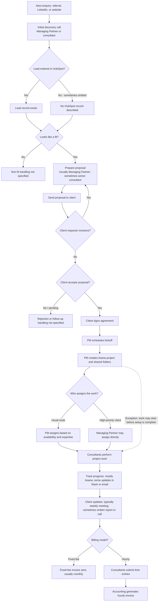

# 1. Process Discovery Analysis

## 1A. Process Summary

### Purpose
The process converts an initial prospect enquiry into a consulting engagement, delivers the agreed work, communicates progress to the client, and invoices for services. The Managing Partner's stated objective is a more standardized end-to-end delivery process that reduces coordination effort and allows the firm to scale consistently.

### Key stakeholders

| Stakeholder | Involvement stated in the transcript | Ownership that remains unclear |
|---|---|---|
| Prospect / client | Makes the initial enquiry, joins discovery, reviews the proposal, signs the agreement, attends kickoff/status discussions, and is invoiced | Who qualifies the client, approves scope, and accepts deliverables |
| Managing Partner (Michael) | Conducts some discovery calls, usually prepares proposals, assigns some high-priority work, and provides operational direction | Approval thresholds, escalation authority, and accountability for process compliance |
| Consultants / senior consultants | Conduct discovery calls, some senior consultants prepare proposals, deliver project work, and submit time entries for hourly work | Who owns each engagement and who ensures records and updates are complete |
| Project Manager (PM) | Schedules kickoff, creates the Asana project and shared folders, and usually assigns work | Authority over scope, staffing conflicts, project health, and exceptions |
| Accounting | Generates invoices for hourly projects; fixed-fee invoices are usually sent monthly | Invoice review/approval, collections, and ownership of fixed-fee invoicing are not specified |

### Systems, tools, and channels referenced

| Tool / channel | Use described | Limitation or uncertainty |
|---|---|---|
| Referrals, LinkedIn, website | Sources of new enquiries | No intake form or common capture method is described |
| HubSpot | Lead logging | Entry is inconsistent; it is not confirmed as the complete system of record |
| Proposal format / documents | Proposals are prepared and sent to clients | A common format exists, but individual approaches vary; repository and version control are unknown |
| Agreement / signature process | Client signs after proposal acceptance | Contract tool, approval workflow, and storage location are not stated |
| Calendar / scheduling | Kickoff is scheduled | Specific scheduling tool and owner are not stated beyond the PM's role |
| Asana | Project creation, task management, and most project tracking | Weekly updates are expected but adoption is inconsistent |
| Shared folders / Google Drive | Project documents are stored in shared folders; Google Drive is one location used | Folder structure and authoritative document location are inconsistent or unclear |
| Spreadsheet | Capacity is tracked | No formal resource-planning system is used; spreadsheet structure and update owner are unknown |
| Slack / email | Alternative channels for project updates and coordination | Updates may not be reflected in Asana or a central record |
| Time-entry method | Consultants submit time for hourly work | Tool, required fields, approval, and submission deadlines are not stated |
| Accounting / invoicing process | Accounting generates hourly invoices; fixed-fee invoices are usually monthly | Accounting system, checks, and invoice delivery process are not stated |

### Major process stages

1. **Lead intake:** A prospect arrives through a referral, LinkedIn, or the website.
2. **Discovery and qualification:** The Managing Partner or a consultant holds an initial call to understand the prospect's needs and assess fit.
3. **Proposal preparation and review:** If the prospect appears to be a fit, the Managing Partner or a senior consultant prepares and sends a proposal. The client may request revisions.
4. **Agreement and kickoff:** After proposal acceptance, the client signs an agreement and a kickoff meeting is scheduled.
5. **Project setup:** The PM creates the project in Asana and sets up shared folders.
6. **Resource allocation:** The PM generally assigns tasks based on availability and expertise. The Managing Partner may assign work directly for high-priority clients.
7. **Project delivery and tracking:** Consultants perform the work. Most projects are tracked in Asana, with weekly task updates expected; some updates are shared through Slack or email.
8. **Client communication:** Weekly status meetings are typical. Some clients receive written reports; others prefer a quick call.
9. **Billing:** Fixed-fee projects are usually invoiced monthly. For hourly projects, consultants submit time entries and accounting generates invoices. Late time entries delay billing.

### Inputs and outputs

| Stage | Main inputs | Expected / observed outputs |
|---|---|---|
| Lead intake | Enquiry, referral, LinkedIn or website contact | Prospect conversation; HubSpot lead record when one is created |
| Discovery / qualification | Prospect's needs and discovery discussion | Understanding of needs and a fit decision; qualification criteria are not documented |
| Proposal | Discovery findings and proposed work | Proposal sent; revised proposal when requested |
| Agreement / kickoff | Client acceptance and agreement | Signed agreement and scheduled kickoff |
| Project setup | Engagement information and kickoff needs | Asana project and shared folders |
| Resource allocation | Required expertise, consultant availability, priority | Assigned tasks / delivery responsibility |
| Delivery / tracking | Project tasks and consultant work | Work outputs and project updates in Asana, Slack, or email |
| Client communication | Project progress and client preference | Status meeting, written report, or call |
| Billing | Fee model; submitted time for hourly work | Monthly fixed-fee invoice or hourly invoice generated by accounting |

### Important decision points

- **Lead fit:** Is the opportunity a fit? A proposal is prepared when it appears to be a fit. The criteria and non-fit path are unknown.
- **CRM capture:** Is the lead entered in HubSpot? Current practice is inconsistent.
- **Proposal revisions:** Does the client request changes? If yes, the proposal is revised; the number of review cycles is not specified.
- **Proposal acceptance:** Does the client approve the proposal? The transcript describes agreement signing after acceptance but does not describe rejected or stalled opportunities.
- **Staffing route:** Does the PM assign work, or does the Managing Partner directly assign work for a high-priority client?
- **Tracking / communication method:** Are updates maintained in Asana or sent through Slack/email? Does the client prefer a meeting, written report, or call?
- **Billing model:** Is the engagement fixed-fee or hourly? This determines the described invoicing path.

## 1B. Information Gaps

### Missing process information

- Lead intake fields, qualification criteria, lead ownership, response-time expectations, and how rejected, dormant, or duplicate leads are handled.
- Whether every lead must be entered in HubSpot, when the record is created, and which fields are mandatory.
- Proposal content standards, pricing/margin rules, approval authority, turnaround targets, revision limits, and version control.
- Agreement type, signature method, storage location, approval requirements, and whether work may begin before signature.
- Kickoff agenda, required attendees, project setup checklist, standard folder structure, access controls, and naming conventions.
- Project planning standards: scope, deliverables, milestones, dependencies, budget, acceptance criteria, and change control.
- Resource planning rules, the spreadsheet's owner and update frequency, capacity definitions, and how conflicts are resolved.
- Asana templates, required fields/statuses, update expectations, escalation rules, and how Slack/email updates are reconciled.
- Client communication standards, report contents, meeting cadence, approval of external reports, and who owns client communication.
- Time-entry tool, submission frequency/deadline, approval responsibility, rate rules, corrections, and treatment of non-billable time.
- Fixed-fee invoice trigger and approval, hourly invoice review, accounting system, payment terms, collections, and dispute handling.
- Quality assurance, risk/issue management, scope changes, project closure, client acceptance, feedback, and lessons learned.
- Security and governance: document access, confidentiality, retention, client data handling, and approved AI/tool usage.
- Current performance baselines such as proposal turnaround, project setup time, update compliance, billing delay, and rework.

### Unclear responsibilities / ownership

- Who is accountable for a lead record being created and kept current.
- Who makes and records the fit decision and who follows up with the prospect.
- Who approves proposal scope, fees, discounts, and final versions.
- Who confirms the agreement is signed before work starts and who authorizes exceptions.
- Whether the PM or Managing Partner has final authority over staffing and capacity conflicts.
- Who owns the authoritative project plan, status record, document repository, and client report.
- Who follows up on missing weekly updates and late time entries.
- Who reviews and approves invoices before they are sent, and who follows up on overdue payment.
- Who owns overall process governance and monitors adherence across engagements.

### Assumptions requiring validation

1. The process described is the typical path, not necessarily the path for every engagement.
2. Proposal acceptance normally precedes agreement signing, and the signed agreement is intended to precede delivery.
3. The PM is the operational owner of project setup, but accountability for the full engagement is not established.
4. Asana is the primary project-tracking tool in practice, but it is not consistently used as the only source of status information.
5. Fixed-fee and hourly are the main billing models described; other commercial models may exist.
6. The monthly fixed-fee billing cadence and hourly time-entry process may have client-specific terms not captured in the transcript.
7. The transcript does not establish whether project closure, deliverable acceptance, or post-project follow-up is in scope.

## 1C. Follow-Up Questions for the Next Stakeholder Session

### Intake and qualification
1. What information must be captured for every new enquiry, and who is accountable for creating the HubSpot record?
2. Should HubSpot be mandatory for all leads, including referrals? At what point should the record be created?
3. What makes an opportunity a good fit (budget, need, timing, expertise, strategic value), and who makes the final decision?
4. What happens to leads that are not a fit, go inactive, or do not respond?

### Proposal and contracting
5. Is there an approved proposal template and standard set of sections? Which elements may consultants customize?
6. Who approves scope, pricing, discounts, assumptions, and the final proposal before it is sent?
7. How are proposal versions, client comments, and approval status tracked? Is there a target turnaround time?
8. What agreement is required, who reviews it, and where is the signed version stored?
9. Is signed agreement completion a mandatory gate before any delivery work starts? Who can approve an exception and how is it recorded?

### Kickoff, setup, and resourcing
10. What must be ready before kickoff and before delivery begins (Asana project, folder, access, scope, staffing, budget, plan)?
11. Is there a standard kickoff agenda and a checklist? Who confirms each setup item is complete?
12. What is the required project folder structure and which location is the official document repository?
13. How is capacity measured and how often is the spreadsheet updated? Who owns it?
14. How are expertise, availability, priority, and competing assignments balanced? Who resolves staffing conflicts?
15. When the Managing Partner assigns work directly, how is the PM informed and the Asana plan updated?

### Delivery and client communication
16. What is the minimum weekly Asana update standard (status, progress, next step, due date, blocker, hours)?
17. Which project updates must be recorded in Asana even when first communicated through Slack or email?
18. Who monitors stale tasks, missed milestones, risks, and client escalations, and what are the escalation thresholds?
19. How is the client's preferred update format and cadence agreed, documented, and reviewed?
20. Are status reports based on a standard template, and who validates them before they are sent?
21. How are scope changes, additional requests, deliverable reviews, and client acceptance documented?

### Billing and governance
22. What are the time-entry tool, submission deadline, required fields, and approval process for hourly work?
23. What reminder and escalation process applies when time entries are late or incomplete?
24. For fixed-fee work, what triggers each invoice and who prepares, reviews, approves, and sends it?
25. What accounting platform, payment terms, expense rules, and invoice-dispute process are used?
26. What does project closure involve (final invoice, deliverable acceptance, access removal, feedback, lessons learned)?
27. Which operational KPIs are already measured, and what baseline performance or recurring failure points can be shared?
28. What client confidentiality, data-retention, access, and AI-use policies must any automation follow?

---

# 2. Process Documentation and Workflow Diagram

## 2A. Current-State Workflow Diagram

The diagram below represents only the workflow described in the discovery transcript. Branches labelled **not specified** are deliberate: the transcript does not explain those outcomes. Optional CRM logging and the early-start exception are shown as part of the current state, not as recommended practice.

**Diagram notes:** The transcript does not describe a formal handoff between sales and delivery, the outcome of a rejected/non-fit lead, project completion, client acceptance of deliverables, payment collection, or a final closeout step. The fixed-fee path is described as monthly invoicing; the hourly path depends on consultant time entries and accounting invoice generation.

## 2B. Structured Process Document

### Process overview

| Attribute | Current-state description |
|---|---|
| Process name | Client engagement lifecycle: lead intake through billing |
| Purpose | Convert prospect enquiries into consulting engagements, deliver services, communicate progress, and invoice clients |
| Start trigger | A prospect contacts the firm through a referral, LinkedIn, or the website |
| End point covered | Fixed-fee invoice is usually sent monthly; accounting generates hourly invoices. Payment and project closeout are outside the transcript's detail |
| Primary participants | Managing Partner, consultants / senior consultants, PM, client, accounting |
| Systems and channels | HubSpot, Asana, spreadsheet, shared folders / Google Drive, Slack, email, and unspecified agreement, scheduling, time-entry, and accounting tools |
| Process characteristics | Several steps are informal or vary by consultant; records and updates can be spread across multiple tools |

### Workflow steps

| # | Step | Responsible party stated | System / record | Output and notes |
|---:|---|---|---|---|
| 1 | Receive new enquiry | Managing Partner or a consultant becomes involved; initial lead receiver is not specified | Referral, LinkedIn, website | New prospect enquiry |
| 2 | Hold discovery call | Managing Partner or consultant | Call; tool not specified | Understanding of prospect needs |
| 3 | Record lead (when done) | Not specified | HubSpot | Lead record; practice is inconsistent, particularly for referrals moving quickly |
| 4 | Assess fit | Decision-maker not explicitly identified | Information from discovery | If it looks like a fit, proceed to proposal; non-fit path is unknown |
| 5 | Prepare proposal | Usually Managing Partner; sometimes senior consultant | Proposal document / format not specified | Proposal; format is mostly similar but individual approaches vary |
| 6 | Send proposal and handle revisions | Proposal preparer; client reviews | Email / sending method not specified | Proposal sent; revisions may be requested and prepared |
| 7 | Accept proposal and sign agreement | Client | Agreement/signature tool not specified | Signed agreement; internal approval and storage are unknown |
| 8 | Schedule kickoff | Project Manager | Scheduling tool not specified | Kickoff meeting scheduled |
| 9 | Set up project | Project Manager | Asana and shared folders | Project created in Asana and folders set up; exact checklist is not stated |
| 10 | Assign work | Usually PM; Managing Partner may assign directly for high-priority clients | Capacity spreadsheet; Asana may hold tasks | Work assigned based on availability and expertise, with a direct-assignment exception |
| 11 | Perform and track delivery | Consultants; PM's monitoring role beyond setup is not fully defined | Mostly Asana; sometimes Slack/email | Project work and progress updates; weekly task updates are expected but inconsistent |
| 12 | Communicate with client | Owner not explicitly stated; typically engagement team | Status meeting, written report, or call | Client receives updates; format varies by client preference |
| 13A | Invoice fixed-fee work | Invoice sender/approver not specified | Invoicing tool not specified | Invoices usually sent monthly |
| 13B | Invoice hourly work | Consultants submit time; accounting generates invoice | Time-entry and accounting tools not specified | Time entries feed invoice generation; late entries delay billing |

### Decision points and current rules

| Decision | Current rule evident from transcript | Information still needed |
|---|---|---|
| Lead fit | Proposal is prepared when the opportunity appears to be a fit | Criteria, decision owner, and non-fit handling |
| HubSpot logging | Sometimes done immediately; sometimes omitted | Mandatory policy, timing, and accountability |
| Proposal revisions | Client may request revisions | Approval process, version history, and revision limits |
| Proposal acceptance | Agreement signing follows acceptance | Rejection, negotiation, and stalled-proposal handling |
| Work assignment | PM generally assigns by availability and expertise; Managing Partner may assign directly for high-priority clients | Conflict resolution, approval, and record-update rules |
| Project updates | Most projects use Asana; some use Slack/email | Minimum required update and central record rules |
| Client updates | Weekly meeting is typical; written report or call may be preferred | How preferences are captured and who approves communications |
| Billing model | Fixed-fee or hourly paths are described | Whether other models exist and specific contract terms |

### Known exceptions and process variations

- A referral may move quickly without being entered in HubSpot.
- Senior consultants sometimes prepare proposals instead of the Managing Partner.
- Clients may request proposal revisions.
- Consultants may start work before project setup is fully complete because the client wants speed.
- The Managing Partner may assign work directly for high-priority clients rather than following the usual PM assignment route.
- Some consultants provide progress updates through Slack or email instead of updating Asana.
- Client reporting varies between meetings, written reports, and quick calls.
- Hourly time entries may be late, delaying invoice generation.

### Assumptions and boundaries

- This is a current-state map, not a proposed future-state process.
- No system is assumed for agreement signing, scheduling, time capture, or accounting because the transcript does not name one.
- No mandatory lead-capture, contract gate, project checklist, or project-closeout control is assumed to exist.
- The diagram ends at invoice generation / issuance because payment collection and project closure were not covered.
- Where the transcript says a role “usually” performs an activity, the table preserves that qualifier rather than treating it as exclusive ownership.

### Areas requiring clarification

The key clarification areas are: mandatory CRM capture; qualification and proposal approval rules; signed-agreement and setup prerequisites; ownership of capacity planning and staffing conflicts; the authoritative project/status/document record; client-update standards; time-entry controls; invoice approvals and payment follow-up; and project closure. These should be resolved before designing automation or measuring compliance.

---

# 3. Process Improvement and AI Opportunities

## 3A. Operational Challenges, Risks, and Inefficiencies

| Priority | Challenge evidenced by transcript | Operational risk / likely consequence |
|---|---|---|
| High | Lead records are not created consistently in HubSpot | Incomplete pipeline visibility, weak handoffs, duplicate follow-up, and limited reporting |
| High | Proposal preparation varies by author | Inconsistent scope, pricing presentation, assumptions, and client experience; more rework |
| High | Work can begin before project setup is complete | Missing agreement/project records, unclear scope or ownership, access/document gaps, and delivery-control risk |
| High | No formal resource-planning system; capacity is tracked in a spreadsheet | Stale capacity information, over-allocation, slow staffing decisions, and key-person dependency |
| High | Progress updates are split across Asana, Slack, and email | Incomplete project visibility, missed blockers, and unreliable status reporting |
| High | Documentation is stored in different locations | Time spent searching, version confusion, inconsistent access, and knowledge loss |
| Medium | Task updates are expected weekly but compliance varies | Project managers may not identify delays or risks early |
| Medium | Client update formats vary by engagement | Inconsistent service experience and manual effort to prepare updates |
| Medium | Late hourly time entries delay billing | Slower invoicing, delayed cash collection, and administrative chasing |
| Medium | Managing Partner may assign work outside the usual PM route | PM may not have a complete view of workload, ownership, or priorities unless assignments are reconciled |
| Unknown / needs validation | No closure, deliverable acceptance, or post-project feedback process was discussed | Potential gaps in confirming completion, capturing learning, and closing access / records |

## 3B. Prioritized Improvement Recommendations

### Priority 1 — Establish minimum process controls before adding AI

1. **Create one end-to-end SOP with clear stage ownership.** Define the entry/exit criteria, accountable role, required record, and handoff for intake, qualification, proposal, contracting, setup, delivery, client updates, and billing. Use a lightweight RACI to resolve the ownership gaps identified in Task 1.
2. **Make HubSpot lead capture consistent.** Agree on a minimum lead record and require it for every enquiry, including referrals. Define who creates it and by when. This improves pipeline visibility and creates a reliable starting point for later automation.
3. **Standardize proposals and approvals.** Use one approved proposal structure with controlled sections for scope, deliverables, assumptions, timeline, fees, and approval. Preserve flexibility where needed, but identify who signs off on commercial and scope exceptions.
4. **Introduce a documented start-work gate.** The default should be that the signed agreement and minimum project setup are complete before delivery begins. Where an urgent exception is permitted, record the approver, reason, scope, and date, and set a deadline to complete the missing setup. This recommendation should be validated against the firm's legal and commercial requirements.
5. **Define a standard project setup and document structure.** Use a repeatable Asana project template and shared-folder convention, with consistent naming, access, required fields, and a clear authoritative location for client and project documents.

### Priority 2 — Improve delivery visibility and accountability

6. **Set a minimum Asana update standard.** Require each active task to show an owner, status, due date, latest progress, next step, and blocker where relevant. Slack/email can remain communication channels, but material decisions and status changes should be reflected in the agreed project record.
7. **Clarify resource-planning ownership.** Assign an owner to maintain the capacity view, define how often it is refreshed, and document how PM and Managing Partner assignments are reconciled. Consider a fit-for-purpose resource tool only after requirements are agreed.
8. **Agree a client communication plan at kickoff.** Record the client's preferred format, frequency, participants, and report owner. Provide a standard status-report outline while allowing agreed client-specific variations.
9. **Set time-entry and billing controls.** Establish a submission deadline, reminder/escalation path, reviewer, correction process, and invoice-generation target for hourly work. Document the monthly invoice trigger and review owner for fixed-fee engagements.

### Priority 3 — Establish governance and continuous improvement

10. **Introduce project health and exception reviews.** Review overdue tasks, missing updates, unassigned work, setup exceptions, scope changes, and late time entries on a regular cadence. Assign an owner and due date to every action.
11. **Define closure and learning practices.** Confirm deliverable acceptance, final billing status, document filing, access changes, client feedback, and lessons learned. These steps need discovery before they can be standardized.
12. **Measure a small set of operational KPIs.** Establish baselines before setting targets. Suggested measures: lead-record completeness; discovery-to-proposal time; proposal revision and approval cycle time; accepted-proposal-to-kickoff time; percentage of projects fully set up before work starts; weekly task-update compliance; overdue milestone rate; on-time time-entry rate; and time from period-end / approved time to invoice issuance.

## 3C. Automation and AI Opportunities

| Opportunity | Current problem | Proposed solution | Expected impact | Assumptions / controls |
|---|---|---|---|---|
| 1. Lead intake and CRM completion | Some enquiries, especially fast-moving referrals, are not logged consistently | Use forms or controlled intake capture to create a HubSpot record. AI could summarize a discovery call and draft structured fields (need, urgency, service area, next step) for human review | More complete pipeline data; less manual data entry; easier handoff and follow-up | HubSpot supports an appropriate integration; call recording/transcription is permitted and consented to; a person validates AI-generated fields and fit decisions |
| 2. Discovery summary and follow-up draft | Discovery knowledge may remain in notes or in an individual's memory; records may be inconsistent | Generate a concise meeting summary, requirements, open questions, risks, and follow-up email draft from approved notes or transcript | Less note-taking and coordination; more consistent discovery records | Use only approved data sources; obtain required consent; human reviews client-facing content; avoid treating AI fit scoring as the final decision |
| 3. Proposal drafting from approved content | Proposal authors use broadly similar but individually variable approaches | Populate an approved proposal template from validated CRM/discovery fields and a controlled library of service descriptions, assumptions, and pricing rules; AI drafts narrative sections | Faster first drafts, more consistent structure, reduced omission risk | Pricing, legal terms, scope, and commitments require human approval; source content and template owner must be established first |
| 4. Contract-to-project handoff | Project setup follows acceptance/signature, but the handoff and checklist are not described as standardized | When an agreement is marked signed, trigger a handoff task or workflow to the PM with required engagement fields and setup checklist; create an Asana project/folder from approved templates where integrations permit | Fewer missed handoffs; faster and more complete setup; traceable ownership | Agreement status can be reliably verified; integration permissions and folder access controls are configured; urgent exceptions remain visible and approved |
| 5. Project provisioning | PM manually creates Asana projects and shared folders | Automate standardized project and folder creation, naming, task templates, and default owners from approved engagement data | Reduced setup effort; consistent project structure | Templates, naming conventions, and ownership rules must be agreed before automation |
| 6. Resource-allocation support | Capacity is tracked in a spreadsheet and assignment decisions are informal | Use structured capacity and skills data to show availability and suggest possible assignments; AI may summarize trade-offs, while PM/Managing Partner makes the decision | Faster staffing decisions and better visibility into workload and expertise | The spreadsheet or replacement system is accurate and maintained; skills and capacity are defined; suggestions are advisory, not automatic staffing decisions |
| 7. Project update consolidation | Some progress is in Asana, while other updates arrive in Slack or email | Automate reminders for missing Asana updates and, where permitted, summarize approved project-channel updates into a draft project note for the owner to validate | Fewer manual chases; more complete project visibility; earlier blocker detection | Data access is authorized; only project-relevant channels are included; the project record remains the source of truth; sensitive messages are excluded |
| 8. Client status report drafting | Clients receive different formats (meeting, report, or call), creating variable preparation effort | Generate a draft weekly status report from validated Asana data: achievements, next steps, milestone status, risks, and decisions needed; tailor the format to the recorded client plan | Faster reporting and more consistent communication without removing client choice | Task data is current; client-facing report is reviewed by the engagement owner before sending; no unsupported progress claims are generated |
| 9. Time-entry reminders and invoice preparation | Late time entries delay hourly invoicing | Send deadline reminders and overdue escalations; validate required fields; after approval, pass eligible time data to the accounting workflow to prepare an invoice draft | Fewer late submissions and less billing delay or rekeying | Time-entry and accounting tools support integration; rates and billability rules are validated; accounting retains invoice review and release authority |
| 10. Document search and classification | Project documents are spread across Asana, Google Drive, email, and other locations | After agreeing the official repository, apply naming/metadata rules and use AI search or classification to help locate and categorize approved project documents | Less time searching; easier handover; lower risk of using an obsolete version | Repository and access rules are defined; indexing respects client permissions and retention requirements; AI does not independently change or delete records |
| 11. Project health alerts | Weekly updates are inconsistent and status may be fragmented | Use rule-based alerts for overdue tasks, missed update dates, unassigned work, setup exceptions, and late time entries. AI can summarize trends and explain the evidence behind a risk flag | Earlier intervention and more focused PM reviews | Reliable structured data and clear alert thresholds exist; alerts are treated as signals for review, not definitive predictions |

### Recommended implementation sequence

| Phase | Focus | Deliverables / exit condition |
|---|---|---|
| **Phase 1: Standardize** | Agree ownership, stage gates, mandatory records, proposal/project templates, folder rules, weekly update standard, and billing deadlines | Approved SOP, lightweight RACI, templates, exception log, and baseline KPIs |
| **Phase 2: Automate repeatable work** | Lead capture, signed-agreement handoff, project/folder provisioning, reminders, and time-entry routing | Reliable integrations with audit trail, exception handling, and named process owners |
| **Phase 3: Add human-reviewed AI assistance** | Discovery summaries, proposal drafts, status-report drafts, resource recommendations, document search, and risk summaries | Tested use cases with measurable time savings, human approval, access controls, and quality monitoring |

### AI governance and success measures

- Keep human accountability for qualification, pricing, scope commitments, staffing decisions, contract approval, client-facing reports, and invoice release.
- Use only authorized client data and connected systems; apply least-privilege access, retention rules, and any required client consent.
- Make generated content traceable to its source records and require review before external use.
- Start with narrow, reversible pilots. Compare baseline and post-pilot measures such as admin time per engagement, lead-record completeness, setup cycle time, update compliance, late time-entry rate, and invoice delay.
- Do not automate inconsistent or undefined decisions. Standardize the process and data first, then automate stable steps, then add AI where interpretation or drafting creates clear value.

## Overall Recommendation

The firm's main issue is not a lack of software; it is the absence of consistently followed process rules, clear ownership, and a dependable project record across the engagement lifecycle. The strongest first move is to standardize the workflow and its controls. Once the firm has reliable lead, proposal, project, capacity, status, and time-entry data, targeted automation and human-reviewed AI can reduce coordination effort without weakening commercial, delivery, or client controls.
